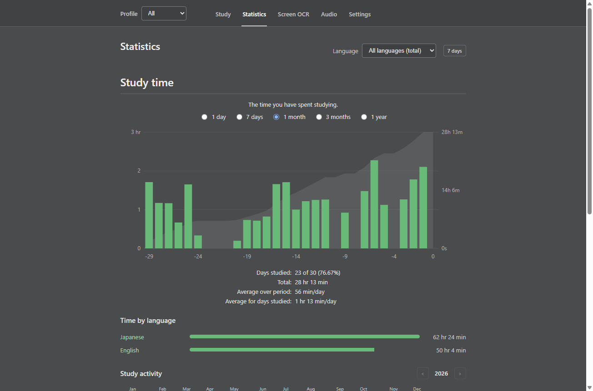
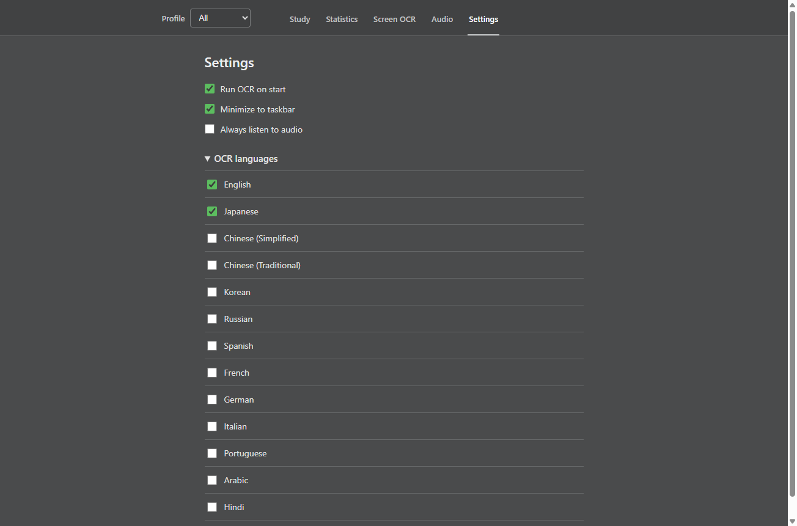
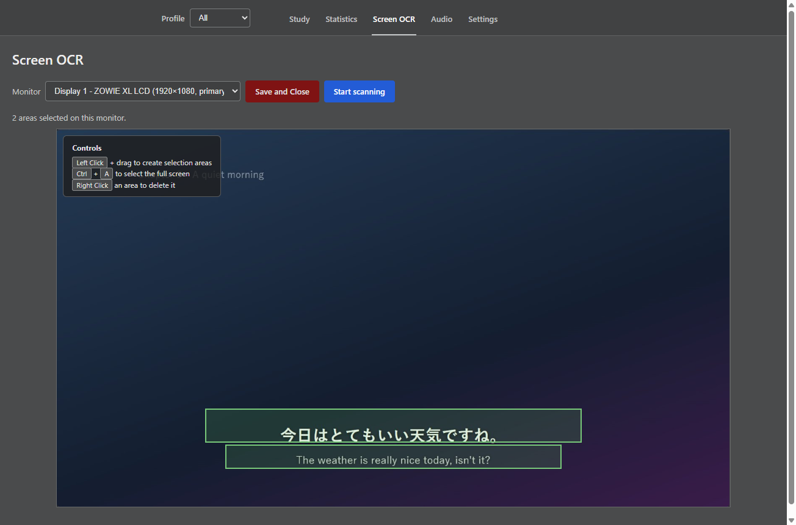
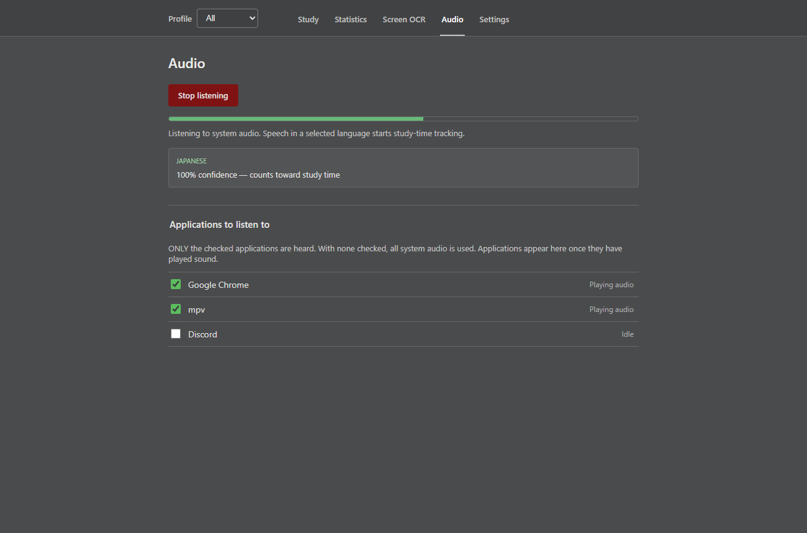

  

<h1 align="center">Immersion Tracker</h1>

  <b>Automatically track the time you spend doing immersion in the language you are learning.</b>

  <a href="https://github.com/nahte-aoz/Immersion-Tracker/releases/latest">Download</a> ·
  <a href="#how-it-works">How it works</a> ·
  <a href="#privacy">Privacy</a> ·
  <a href="#acknowledgements">Acknowledgements</a>

---

Immersion Tracker runs next to your games, videos and anime and logs study time for you. It watches the screen for text and listens to the sound your computer plays, and when it recognizes the language you are studying, the timer runs. 

## Features

- **Screen OCR** – draw one or more areas on any monitor (subtitles, a game's text box, etc.). Text in your study language starts the timer.
- **Audio language detection** – listens to what your PC is playing (not your microphone), spots speech, and identifies the spoken language. Optionally only listen to the applications you tick (e.g. your browser but not Discord).
- **Language profiles** – pick one language (e.g. Japanese) and only that language is detected and logged, or pick **All** to track every language you selected in Settings.
- **Statistics** – an Anki-style chart (1 day, 7 days, 1 month, 3 months, 1 year), a yearly activity calendar, time per language, and a list of recent sessions you can delete.
- **Manual timer** – a plain start/stop timer is always available.
- **Runs in the background** – optional "Run OCR on start", "Always listen to audio" and "Minimize to tray" settings.
- **Works out of the box** – the OCR engine, speech models and everything else are bundled in the installer. There is nothing else to download or set up.

## Getting started

1. Download **`immersion-tracker-<version>-setup.exe`** from the [latest release](https://github.com/nahte-aoz/Immersion-Tracker/releases/latest).
2. Run it. Windows may show a *"Windows protected your PC"* (SmartScreen) message, choose **More info → Run anyway**.

**Requirements:** Windows 10 (version 2004 or newer) or Windows 11, 64-bit. Windows 11 is recommended: the app reads text with **OneOCR**, the text engine of the Windows Snipping Tool. It is copied from your Windows installation the first time OCR runs, so nothing needs installing. On Windows 10, where OneOCR isn't available, the app falls back to Windows' built-in OCR, which needs the matching language pack installed (Settings -> Time & language -> Language).

## How to use

### Study
The **Study** tab has a manual **Start session / Stop and save** timer. Time is only saved when a session ends (or when you quit the app, so you never lose a running session).

### Pick your languages and a profile
- In **Settings -> OCR languages**, tick every language you study.
- Use the **Profile** menu in the top bar to choose **All** or a single language. With a single language selected, only that language counts: Japanese audio will not start the timer while the English profile is selected, and vice versa.

### Screen OCR
1. Open the **Screen OCR** tab and choose the **Monitor** to scan.
2. Press **Select areas** and drag over the text you want read. **Left click + drag** creates an area, **Ctrl + A** selects the full screen, **Right click** on an area deletes it. Your areas are remembered, per monitor.
3. Press **Start scanning**. Whenever text in a selected language appears in an area, the timer runs; it keeps running for a short grace period after the text disappears so brief gaps don't split your session.

Any part of the app's own window that is showing over a scanned area is ignored, so it never reads itself.

### Audio
Open the **Audio** tab and press **Start listening**. The meter shows the sound being heard. Speech is detected and its language identified on your PC; when it matches your profile, the timer runs.
- **Applications to listen to** – tick applications (they appear once they have played sound) to listen to only those. Leave all unticked to hear everything your PC plays.
- **Settings -> Always listen to audio** – listening starts with the app and resumes the timer whenever target language audio is heard.

## Privacy

Everything happens on your computer.
- Screen text is recognized by a bundled OCR engine running locally. Only on-device engines are enabled – no cloud OCR.
- Audio is analyzed in memory and discarded straight away. **No audio is recorded, saved or uploaded**, and no screenshots are stored.
- Your sessions and settings are stored in a local database at `%APPDATA%\Immersion Tracker\`.
- Immersion Tracker itself makes no network connections. The only network access is the bundled OwOCR program, which at startup asks PyPI which OwOCR version is newest (no screen, audio or personal data is sent).

## Troubleshooting

- **"OwOCR … did not start" / OCR does nothing** – make sure nothing else is using port 17331, then restart the app. Anti-virus software occasionally blocks the bundled OCR program; allow it if prompted.
- **Japanese/other text isn't detected** – select the language in Settings -> OCR languages, and make sure the right Profile is chosen.
- **Audio isn't detected** – check the meter on the Audio tab moves while sound plays. If you ticked applications, only those are heard.
- **Can't find the window** – it is in the system tray (Minimize to tray). Click the tray icon.

## Acknowledgements

Immersion Tracker is inspired by [GameSentenceMiner](https://github.com/bpwhelan/GameSentenceMiner) by bpwhelan and [Anki](https://apps.ankiweb.net/). It also uses the work of many open-source projects:

- [OwOCR](https://github.com/AuroraWright/owocr) by AuroraWright – the bundled OCR engine host (GPL-3.0). Its OneOCR engine uses the text recogniser of Windows' Snipping Tool.
- [OpenAI Whisper](https://github.com/openai/whisper) (MIT) and the ONNX export by [Xenova / Transformers.js](https://huggingface.co/Xenova/whisper-base) (Apache-2.0) – spoken language identification.
- [Silero VAD](https://github.com/snakers4/silero-vad) (MIT) – speech detection.
- [ONNX Runtime](https://github.com/microsoft/onnxruntime) (MIT).
- [loopback-capture](https://github.com/WerdoxDev/loopback-capture) by WerdoxDev (MIT) – per-application audio capture.
- [franc](https://github.com/wooorm/franc) (MIT) – text language detection.

Full license information is in [THIRD_PARTY_NOTICES.md](THIRD_PARTY_NOTICES.md) and is also installed with the app.
